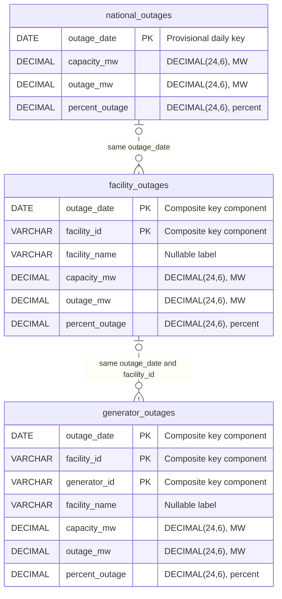

# Implemented analytical data model

This document describes the code in `analytics.py`, `extract_eia.py`, `refresh_eia.py`, `diagnostics.py`, and `api/query.py`, rather than a proposed warehouse. See the [README real-data report](../README.md#real-data-reconciliation-evidence-us-07), [schema observations](EIA_SCHEMA.md), and [refresh/recovery guarantees](EIA_INCREMENTAL_REFRESH.md). The known facility count discrepancy still prevents accepted real-data publication; the diagnostic archive is not a snapshot.

## Grains, exact types, and source mapping

There are three DuckDB **views over the three physical Parquet files of one selected immutable run**. There are no persisted DuckDB fact/dimension tables, database primary/foreign-key constraints, or separate facility/generator dimension inventories.

| Analytical column | National view | Facility view | Generator view | Source / physical Arrow type | DuckDB type and contract |
| --- | --- | --- | --- | --- | --- |
| `outage_date` | Yes | Yes | Yes | `period`: `date32[day]` | `DATE`, required daily date |
| `facility_id` | — | Yes | Yes | `facility`: `string` | `VARCHAR`, required nonblank opaque identifier |
| `generator_id` | — | — | Yes | `generator`: `string` | `VARCHAR`, required nonblank ID scoped to facility |
| `facility_name` | — | Yes | Yes | `facilityName`: nullable `string` | `VARCHAR`, nullable descriptive label |
| `capacity_mw` | Yes | Yes | Yes | `capacity`: `decimal128(24,6)` | `DECIMAL(24,6)`, required reported capacity MW |
| `outage_mw` | Yes | Yes | Yes | `outage`: `decimal128(24,6)` | `DECIMAL(24,6)`, required reported outage MW |
| `percent_outage` | Yes | Yes | Yes | `percentOutage`: `decimal128(24,6)` | `DECIMAL(24,6)`, required reported percent, not a fraction |

Each physical Parquet file also retains non-null string fields `capacity-units`, `outage-units`, and `percentOutage-units`, constrained by validation to `megawatts`, `megawatts`, and `percent`. They are not projected into the analytical views. Only `facilityName` is nullable in physical schemas; absence is normalized to null. View nullability/uniqueness are validated application contracts, not SQL DDL constraints. Projection preserves types without casts or rounding.

| View / file | Meaning | Enforced provisional natural key within one snapshot |
| --- | --- | --- |
| `national_outages` / `us-nuclear-outages.parquet` | One EIA national fleet observation per day | `outage_date` (`period` physically) |
| `facility_outages` / `facility-nuclear-outages.parquet` | One reported facility observation per day | `(outage_date, facility_id)` |
| `generator_outages` / `generator-nuclear-outages.parquet` | One reported generator observation per facility/day | `(outage_date, facility_id, generator_id)` |

Keys are checked within each extraction and stored snapshot, and used for overlap merging. They remain provisional across full history: identifier reuse and lifecycle rules have not been established. A generator ID alone is not unique; names are not keys. The same natural key in separate snapshot versions is expected and must not be combined by globbing files across runs. No surrogate IDs or version columns are added to the view rows.

## Logical ER diagram

The boxes below are the **actual analytical views**, not new physical tables. `PK` labels mean provisional, application-enforced composite natural-key components. Dashed optional relationships are comparison paths; they are **not foreign-key constraints or promises that parents/children always exist**. Optionality reflects the defensive diagnostic model, not permission to violate the production route-date coverage requirement.

National observations remain independent source totals. Compare generator sums with facility rows **after aggregating by `(outage_date, facility_id)`**, and independently aggregate each source grain by date for national comparisons. Joining raw children to parents and summing parent measures multiplies values. Percentages are not additive; daily MW is not energy accumulated across time.

## Invalid records, duplicates, and relationships

- Required dates, identifiers, measures, and units must validate. Numeric strings are parsed as exact Decimal values; blanks, null measures, booleans, nonfinite values, overflow beyond 18 integer digits, and values requiring more than six fractional digits fail. No zero-fill or silent precision loss is permitted. Unexpected row fields or incompatible physical schemas fail review; additional unrequested metadata measure definitions do not automatically add columns.
- Missing `facilityName` becomes null; labels need not be nonempty to establish identity. A changed valid label is an ordinary full-row overlap conflict, subject to the documented policy. Numeric-looking identifiers remain strings, including leading zeros and letters.
- Duplicate keys within incoming or stored data fail even when rows are identical. Across validated overlap windows, identical typed rows merge once. Conflicting rows fail by default; explicit `replace` replaces the entire incoming row, never an ambiguous duplicate. Disappearing stored keys inside the overlap fail under both policies. No implicit source-deletion/tombstone inference is implemented.
- Every route must cover every requested date, have stable reported pagination totals matching received rows, and pass schema/value/key checks before publication. Coverage and count consistency are not proof of authoritative fleet coverage. The facility count mismatch is still fatal to production publication.
- A **generator with no matching facility/day** is not rejected merely for lacking a parent: no cross-route FK is implemented. It remains in its own grain if route-local checks pass. `reconcile_facilities` full-outer joins generator aggregates and facility observations, returning `missing_level` with null parent values/gaps; it does not fabricate a facility, drop the generator, or substitute zero. Missing child groups are retained similarly. Dataset preview/SQL preserve those rows; the Analyst/Admin `/reconciliation` workspace now exposes these comparisons and reasons through the same app-owned production/demo reader.
- Nonzero cross-grain capacity/outage gaps are returned exactly as `source_comparison` / `difference`, without an arbitrary tolerance, forced balancing, or assumed causal explanation. Definitions, coverage, revisions, and reporting timing may differ; these are hypotheses until evidenced. Such gaps are not automatic ingestion errors.
- Negative/out-of-range finite measures are representable and not universally prohibited by extraction. `find_anomalies` marks negative capacity/outage, outage above capacity, or percent outside 0–100 as `review`. Missing/invalid/duplicate defensive diagnostics are `data_quality`. These categories do not claim that all range flags violate EIA's source contract. The US-08 calculation withholds percentages for zero/missing/invalid/ambiguous inputs using explicit statuses; zero capacity does not become a 0% share.

## Current data, publication metadata, and ingestion history

These are **filesystem JSON documents**, not additional relational tables:

| Artifact | Relation to analytical data |
| --- | --- |
| `current.json` | The authoritative pointer to `runs/<version>`. Its atomic replacement commits all three route files together. |
| `runs/<version>/manifest.json` | Defines files, exact route record counts, candidate keys, start/end, and schema version. Version 2 also embeds `snapshot_version`, per-route `watermarks`, and the completed `ingestion_run`. |
| `ingestion-runs/<run-id>.json` | Durable run audit mirror: requested dates, timestamps, status, per-route counts, before/after watermarks, safe failures, base version, and published version. Failed/no-op attempts do not create a new published snapshot. |
| In-memory refresh API job | A separate random `job_id`, safe pending/running/terminal state, and progress counts. It is not a DuckDB table or durable ingestion-run identifier. Restart loses job lookup; engine audits remain. |

A version-2 successful ingestion run ID equals its snapshot version; its immutable manifest embeds success before pointer commit. An unreferenced manifest alone never proves publication. Older version-1 window manifests have no stored watermarks or embedded audit; the reader derives maxima only after fully validating the physical data.

`open_analytics` resolves the pointer once, validates all three physical files and applicable publication metadata, then creates views over those exact paths. It never repairs audits or opens staging/orphan files. Even authorized national-only reads require a complete three-route publication internally. Existing connections keep their old version while refresh stages/publishes a new one; old immutable files are retained. Manual mutation/deletion is unsupported. Opening currently scans full datasets for validation, which is a scalability cost rather than extra persisted copies.

Each route watermark is its latest **successfully published** date and must equal its stored maximum and manifest end; all three agree. For stored start `S`, common watermark `W`, and overlap `N`, incremental start is `max(S, W + 1 day - N days)`. New data merge with overlap corrections under the key policy above; the entire cumulative snapshot is validated and rewritten locally. Overlap 0 with end `W` produces an audited no-op, leaving the pointer/watermarks unchanged (`base_snapshot_version` identifies existing data; the audit's `published_snapshot_version` stays null).

The writer holds one local POSIX lock per output root. Files/directories are flushed/fsynced before publication and the pointer directory after replacement. An interruption after pointer commit is reconciled against the actual validated pointer/manifest, not an in-memory success flag. Recovery restores the current audit mirror from the authoritative manifest; corrupt historical mirrors are preserved as `.corrupt` evidence, while corrupt current pointers/data/publication metadata block refresh. Failed pre-commit runs do not replace data or advance watermarks. Atomic visibility and requested fsync ordering do not establish universal power-loss durability on every filesystem/device; see the [detailed recovery limitations](EIA_INCREMENTAL_REFRESH.md#ingestion-run-metadata-and-failures).

The isolated `analysis_eia` archives and the explicitly separate read-only demo never call production publication/recovery or update these artifacts. The demo materializes archive-derived Parquet with `demo.json` under `data/eia-demo`, has no production pointer/manifest/audit/watermark, and is rejected by production loading/base adoption. Only the separate demo API entry point installs its app-local reader after the same endpoint authorization/SQL checks; the production app remains unchanged. Their `production_eligible=false` label and unresolved count flag remain even when totals reconcile exactly.

## Seven explicit design decisions

### 1. Natural keys retain each source grain

**Chosen:** date; date/facility; date/facility/generator, enforced in application validation and scoped to one selected snapshot. **Rejected:** surrogate row IDs or a globally unique generator ID. **Rationale/trade-off:** natural keys allow explainable duplicate detection and overlap merging without erasing grain or opaque identifiers. They depend on provisional source identity/lifecycle assumptions, so full-history uniqueness is not claimed.

### 2. Current means the atomic published snapshot; refresh overlaps watermarks

**Chosen:** immutable Parquet runs selected by one current pointer, per-route watermarks embedded with version-2 data/audit, and bounded configurable overlap with default conflict rejection. **Rejected:** append-only files with independent route/watermark updates, or a last-success timestamp separate from publication. **Rationale/trade-off:** readers cannot mix partial routes or advance freshness ahead of data, and overlap corrections are explicit/idempotent. Full cumulative merge/validation rewrites use memory and disk proportional to history; readers do not pin across separate HTTP requests.

### 3. Preserve orphans and explain cross-grain mismatches

**Chosen:** enforce route-local integrity, retain orphan generators, and full-outer compare preaggregated children with parents; report signed gaps without forced balancing. **Rejected:** inferred physical foreign keys, dropping unmatched children, or reconstructing a parent total to hide differences. **Rationale/trade-off:** source definitions and lifecycle coverage are not fully established, so comparison evidence must not invent a master inventory. Orphans/gaps can remain visible; not every mismatch is a proven defect or automatic extraction failure. This does not relax route pagination completeness.

### 4. Refresh is asynchronous within one API process

**Chosen:** Admin-only in-process background worker, 202 admission, polling by job ID, and single-active-job admission plus the pipeline filesystem lock. **Rejected:** blocking long HTTP refresh requests or adding Celery/Redis/brokers. **Rationale/trade-off:** bounded local infrastructure suits slow EIA requests while existing snapshots remain readable. API jobs are not durable across restarts, graceful shutdown may wait, and deployment requires a single API worker; durable ingestion audits are distinct from job status.

### 5. SQL is a compiled, deliberately small read-only subset

**Chosen:** SQLGlot AST validation and reconstruction of one SELECT on one approved view, plain column/star projections, constrained predicates, ORDER BY, and LIMIT. **Rejected:** executing raw SQL after a regex/prefix check, or accepting broad DuckDB SELECT syntax. **Rationale/trade-off:** rejecting writes, multiple statements, CTEs, subqueries, joins, unions, functions/table functions, qualified tables/columns, aliases, external scans, PRAGMA, ATTACH, COPY, and unknown nodes closes resource-access paths. Literals become bound parameters. The server fetches at most 201 and returns at most 200 rows with truncation status; API SQL length is capped at 10,000 characters and AST size at 512 nodes. Aggregation and advanced SQL are intentionally unavailable; result limits do not bound all execution work or provide a query timeout.

### 6. Every accepted table reference is authorized before data access

**Chosen:** require Analyst/Admin first, structurally require exactly one SELECT and one Table node in the full AST, accept only an unqualified canonical table from `DATASETS`, then invoke centralized `authorize_datasets` before `open_analytics`. Every unrecognized construct fails closed rather than escaping table discovery. **Rejected:** checking only the first textual FROM, trusting a client dataset list/frontend hiding, or accepting nested SQL with incomplete reference authorization. **Rationale/trade-off:** the accepted subset has one exhaustively checked reference; nested/indirect references cannot enter execution. Viewer cannot use `/query` even for national data; catalog/preview and the national metric separately apply dataset policy. Broader future SQL must extend AST authorization first. Trusted local Python/DuckDB helpers themselves are not an authorization sandbox.

### 7. Preserve exact values and separate evidence from acceptance

**Chosen:** non-null fixed Decimal storage for measures, explicit units, strict schema/record validation, nullable labels, and non-production archives for unverified source analysis. **Rejected:** floating-point coercion, zero-filling invalid measures, automatic schema widening, or replacing an inconsistent EIA total with the observed key count. **Rationale/trade-off:** exact gaps and reproducible evidence survive without silent rounding or false completeness. The storage policy rejects otherwise numeric data needing greater precision; the facility mismatch blocks useful production data until its semantics are independently resolved. An internally consistent archive or a coordinated capacity change is not automatically a complete publication or a source anomaly.

## Reproduction and remaining deliverables

The [README temporal report](../README.md#offline-temporal-investigation-and-anomaly-shortfall) includes exact values, candidate classification, source references, and commands. The Mermaid ER, type/key mapping, relationship behavior, publication/audit description, and **exactly seven decisions above** are complete. The requirement for three independent defensible anomalies remains unmet: zero confirmed source-data defects and one independently verified API count inconsistency. Production completeness remains unresolved; no synthetic facts or accepted real snapshot are substituted.
